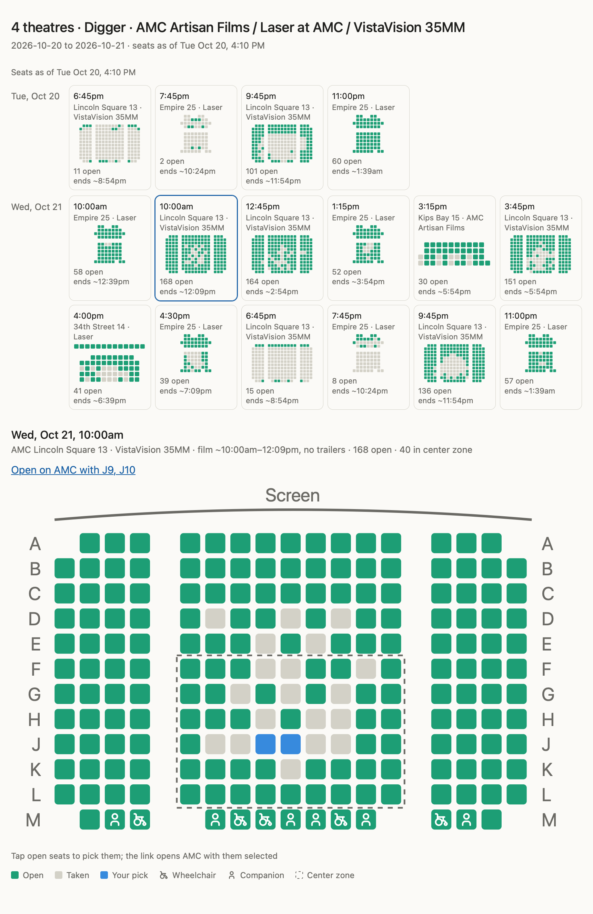

# amc-seats

An agent skill that finds AMC showtimes for a movie and shows every seat at every show as interactive seat maps, with the best open seats ranked. Ask your agent "Digger in Dolby this weekend" or "good seats for Dune in IMAX 70mm at Lincoln Square" and it comes back with a seat map for each show.



- Searches one theatre, or every nearby AMC that lists the movie (`--theatre all`), over a date range.
- Gives each show a mini seat map with its theatre, format, open-seat count and estimated end time. The best show also gets a full map with the screen, the row letters, a dashed center zone, and wheelchair and companion seats.
- Ranks side-by-side seats by how centered they are and how far back, about two-thirds of the way back being ideal.
- Estimates the film's start and end. AMC runs 25–30 minutes of trailers, and "No Trailers" shows start on time.
- Lets you tap seats on the map. The "Open on AMC" link opens AMC's seat page with those seats selected. You buy on AMC; the skill only reads.
- When nothing matches, says where the movie is playing and in which formats.

In the Claude desktop and web apps the map renders inline in the chat. Elsewhere it's a self-contained HTML page you open in a browser.

## Install

Claude Code, as a plugin:

```
/plugin marketplace add chetangoel01/amc-seats
/plugin install amc-seats@amc-seats
```

Any agent the [skills CLI](https://github.com/vercel-labs/skills) supports (Claude Code, Codex, Cursor and others):

```bash
npx skills add chetangoel01/amc-seats -g
```

It needs [uv](https://docs.astral.sh/uv/), which installs the scripts' only dependency (Playwright), and a one-time WebKit download:

```bash
uv run --with playwright==1.62.0 playwright install webkit
```

## Use

Ask in plain words. The agent asks which dates if you don't say, then runs [`find_seats.py`](skills/amc-seats/scripts/find_seats.py) once. You can also run the script yourself:

```bash
uv run skills/amc-seats/scripts/find_seats.py --movie digger --theatre all --format laser --from 2026-10-24 --to 2026-10-25 --out /tmp/digger.html
```

The defaults are New York's (market `new-york-city`, AMC Lincoln Square 13). Elsewhere, pass `--market` and `--theatre`; the market is the slug in a theatre's URL, `amctheatres.com/movie-theatres/<market>/<theatre>`. [`SKILL.md`](skills/amc-seats/SKILL.md) documents every flag.

## Limits

- AMC sits behind Cloudflare. The script drives a headless browser, works from a home connection and gets blocked from datacenter IPs. It runs once per request and backs off on HTTP 429, and it never solves CAPTCHAs. Hitting AMC repeatedly gets you rate-limited for a few minutes.
- It reads AMC's public pages, not an API, so it breaks when AMC changes them. The "When it breaks" section of `SKILL.md` lists what the parser depends on.
- It only reads: it never selects, holds or buys seats, and never signs in.

## Development

After changing the seat map or its script, build a page and run the browser check. It taps seats in headless WebKit, checks the AMC link and the icons, and saves a screenshot:

```bash
uv run skills/amc-seats/scripts/check_widget.py /tmp/digger.html /tmp/check.png
```

To rebuild a page from a saved run without hitting AMC, pass the run's `.json` with `--from-json`.

Not affiliated with or endorsed by AMC Theatres. Wheelchair and user icons are from [Tabler Icons](https://tabler.io/icons) (MIT). MIT licensed; see [LICENSE](LICENSE).
